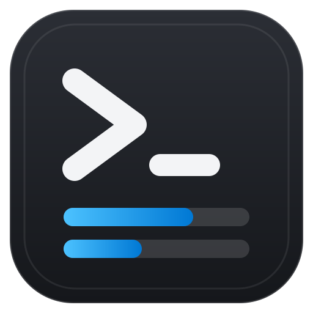
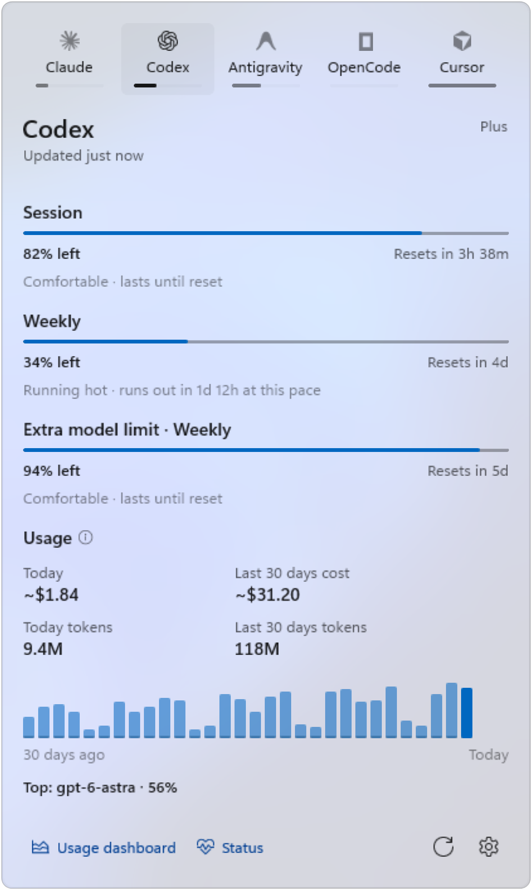

<p align="center">
  
</p>

<h1 align="center">Ration</h1>

<p align="center">AI coding quotas in your Windows tray.</p>

<p align="center"><b>English</b> · <a href="README.tr.md">Türkçe</a></p>

<p align="center">
  <a href="https://github.com/ozkancirak/Ration/releases/latest"></a>
  <a href="https://github.com/ozkancirak/Ration/actions/workflows/ci.yml"></a>
  
  <a href="LICENSE"></a>
</p>


<p align="center">
  <picture>
    <source media="(prefers-color-scheme: dark)" srcset="docs/screenshots/flyout-en-dark.png">
    
  </picture>
</p>

## Features

- Session and weekly quota left, with reset times and a pace hint
- Tray icon that fills with your remaining quota; hover it to see each provider's remaining quota
- Token totals and estimated cost for the last 30 days from local logs
- Notifications when a quota runs low (you choose 10-50%) and when it runs out, switchable per provider
- Keyboard friendly: arrow keys switch providers, F5 or Ctrl+R refreshes, and an optional global shortcut (Ctrl+Alt+R by default, off until you turn it on in Settings) opens the panel from anywhere; the pin button keeps it open while you work
- Native Windows look (Mica and Acrylic), light and dark theme, English and Turkish interface
- Updates itself: checks once a day, installs with one click, downloads only what changed

## Providers

| Provider | Reads (read-only) | Talks to | Shows |
|---|---|---|---|
| Claude Code | `~/.claude/.credentials.json`, session logs | `api.anthropic.com` | Session and weekly quota; cost from logs |
| Codex | `~/.codex/auth.json`, session logs | `chatgpt.com` | Session and weekly quota; cost from logs |
| Antigravity | the app's local language server | `127.0.0.1` only | Quota and token usage |
| OpenCode | `~/.local/share/opencode` (`auth.json`, `opencode.db`) | `opencode.ai` (Go plan, when signed in) | Go plan quota; local usage and free model counter |
| Cursor | Cursor's local storage (`state.vscdb`) | `cursor.com` | Plan usage and billing cycle |

Ration never writes to those files and does not renew sign-ins. Tokens are sent only to the address in the table, only for the request that needs them.

## Install

Download `Ration-win-x64-Setup.exe` or the portable zip from [Releases](https://github.com/ozkancirak/Ration/releases). Requires Windows 10 1809 or later; designed for Windows 11. Unsigned builds may trigger a SmartScreen warning.

### Verify a download

Every release has a `SHA256SUMS.txt` file listing the SHA-256 hash of each file. Download it next to the installer and compare:

```powershell
Get-FileHash .\Ration-win-x64-Setup.exe -Algorithm SHA256
Select-String Setup .\SHA256SUMS.txt
```

The two hashes must match (PowerShell prints upper case, the file lower case). With a Unix-style shell: `sha256sum -c SHA256SUMS.txt --ignore-missing`. The built-in updater checks its own downloads; the file is for manual downloads.

## Privacy

Credential files are read-only; Ration never refreshes or stores them. For Cursor, the session token in Cursor's local storage is sent only to cursor.com. No telemetry. Quota requests go straight to each provider's own endpoint, and responses are redacted before anything is logged. An installed Ration also checks GitHub Releases once a day for a new version; nothing is downloaded until you choose to.

## Data

Ration keeps its files in `%LOCALAPPDATA%\Ration` (the installer lives there too):

- `settings.json`: your preferences (language, theme, refresh interval, tray provider, notifications, last update check)
- `pricing.json`: cached model prices
- `snapshots\`: last quota readings
- `ration.log`: diagnostic log with secrets redacted

Settings has buttons to open this folder and to reset the settings.

To remove Ration, uninstall it from Windows Settings > Apps. That removes the app, its start-with-Windows entry, its notification registration and the whole folder above, settings included. If you use the portable zip, turn off *Start with Windows* first, then delete the zip folder and `%LOCALAPPDATA%\Ration`.

## Development

```powershell
dotnet build Ration.slnx
dotnet test tests\Ration.Tests
dotnet run --project src\Ration.Cli -- usage -p all
powershell -ExecutionPolicy Bypass -File scripts\package.ps1
```

Log file: `%LOCALAPPDATA%\Ration\ration.log`.

To try the update path without GitHub, pack two versions with `vpk pack` into one folder, install the older one and start it with `RATION_UPDATE_REPOSITORY` set to that folder.

## License

MIT. Provider marks from [Simple Icons](https://simpleicons.org) (CC0), [lobe-icons](https://github.com/lobehub/lobe-icons) (MIT) and the official OpenAI logo.
